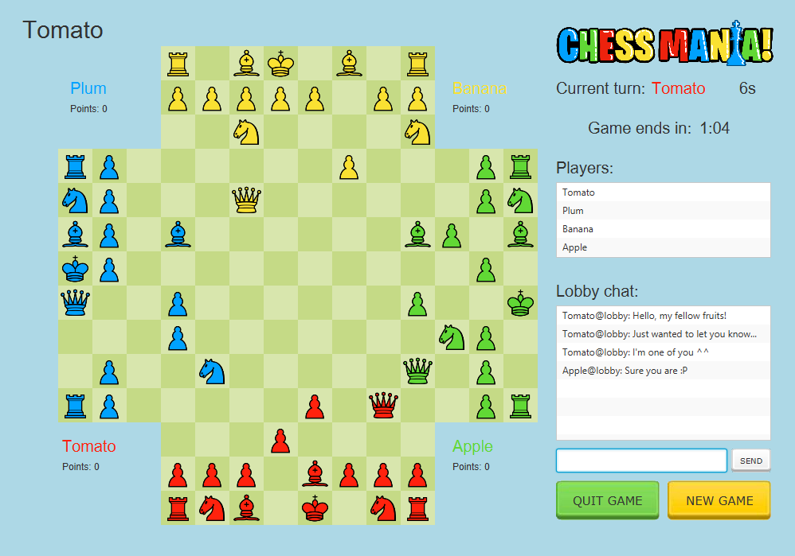
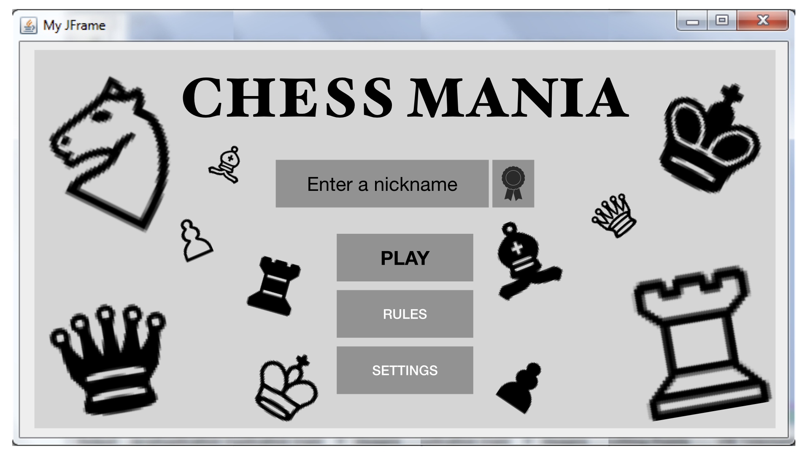
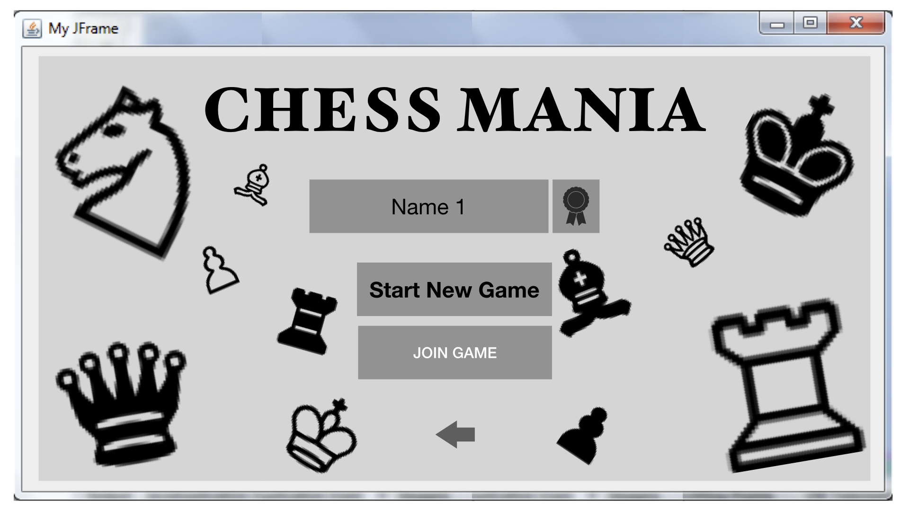
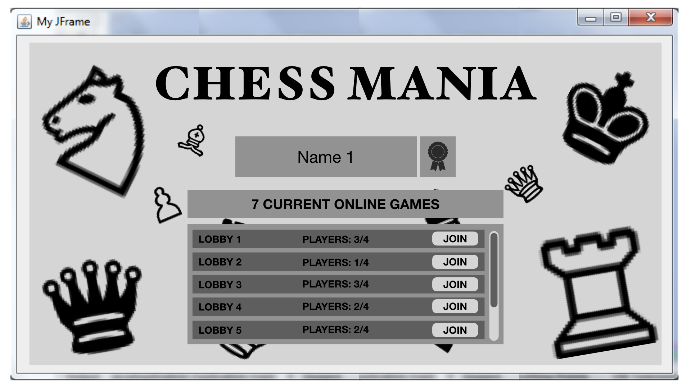
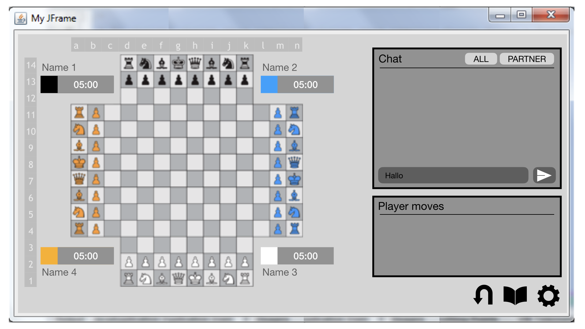
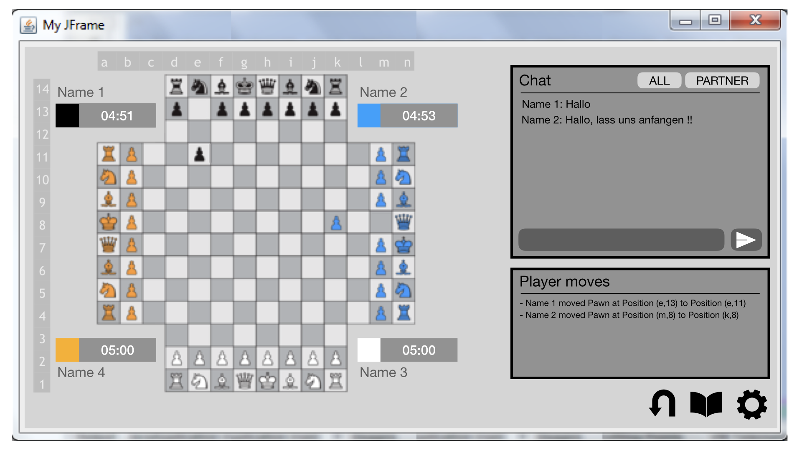
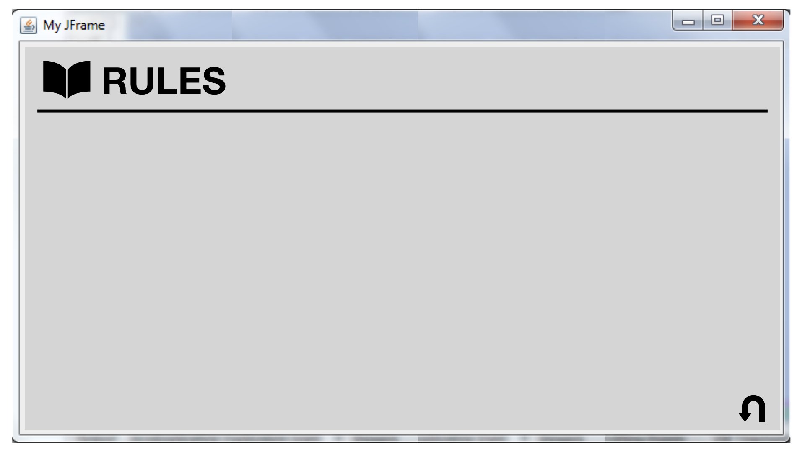
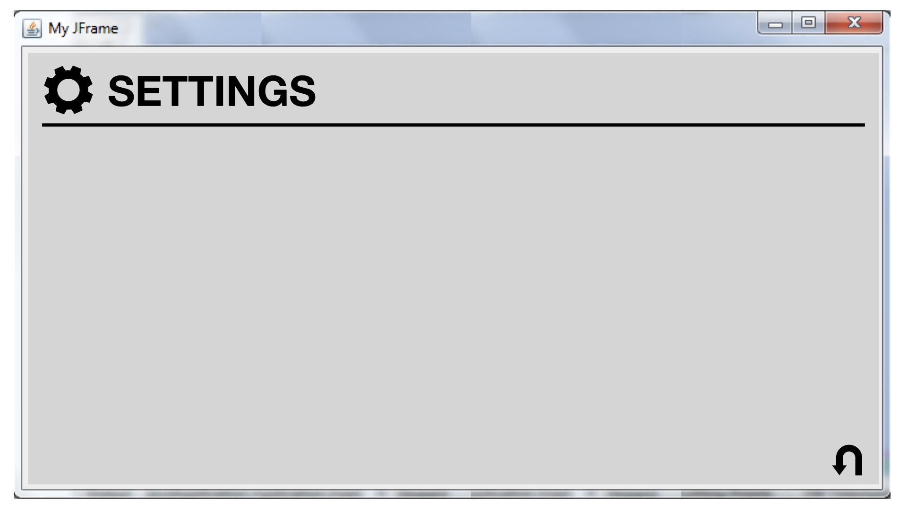
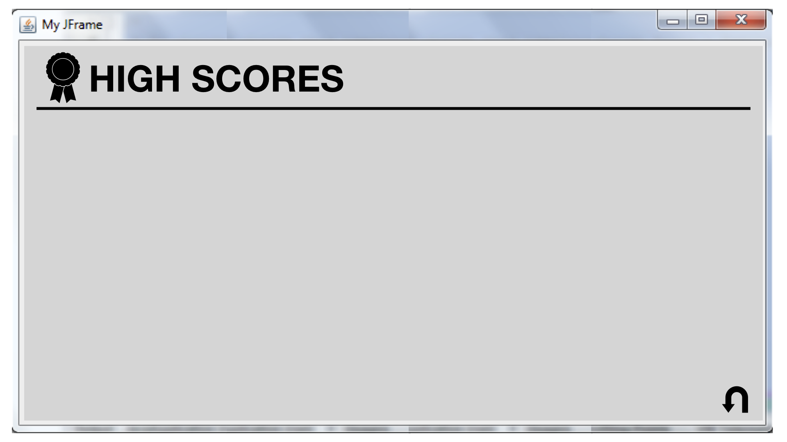
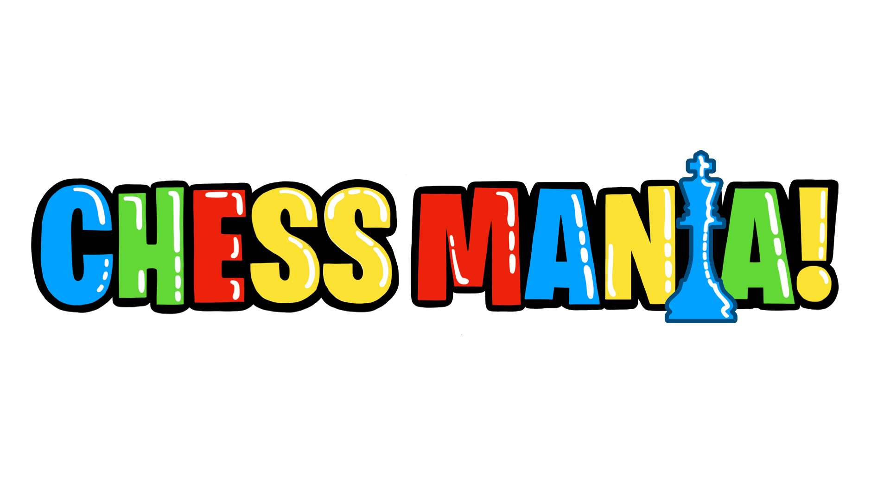

# ♟️ CHESS MANIA!

<div align="center">
  

  **Four players. Two teams. One chessboard.**

  A team-based, four-player chess variant developed in Java as a university programming project at the University of Basel.
  
  [🎬 Gameplay Video](outreach/video.mp4) · [📖 Game Manual](milestones/milestone3/Game%20Manual%20-%20CHESS%20MANIA!.pdf) · [🖼️ Screenshots & Mockups](#-design--visual-development)
</div>

---

## 📌 About the Project

**Chess Mania** is a multiplayer chess game that reimagines traditional chess as a four-player, team-based experience. Instead of playing one-on-one, four players compete on an extended chessboard, forming two opposing teams.

The game was developed collaboratively by **André Vieira Ribeiro (Me) and Mark Starzynski** as part of the *Programmierprojekt FS21* course at the University of Basel.

This repository is a **re-upload of the original university project** for portfolio and archival purposes. The source code, design materials, and documentation reflect the project's original development; the project has not necessarily been updated or tested against current software environments.

## 🎮 Gameplay

<div align="center">
  
</div>

### ♟️ Four-Player Team Chess

Chess Mania expands the traditional chessboard to accommodate four players, each controlling a set of 16 pieces. Players sit on four sides of the board and take turns moving their pieces.

- **4 players** compete in a single match.
- **2 teams** work together to defeat their opponents.
- **4 piece colours** distinguish the players.
- **1 shared objective:** checkmate an opposing team's king.

Teammates sit opposite each other and cooperate strategically. Capturing an opposing king ends the game and determines the winning team.

### 🧩 How It Works

The game retains familiar chess piece movements while introducing a larger board and team-based strategy.

- **Turn-based gameplay:** Players take turns moving one piece.
- **Piece movement:** Pawns, knights, bishops, rooks, queens, and kings follow their respective movement rules.
- **Captures:** Opposing pieces can be captured by moving onto their occupied squares.
- **Team strategy:** Teammates coordinate attacks and support each other's defence.
- **Victory conditions:** The team that checkmates an opposing king wins.

For the complete rules and details of the four-player variant, see the [Game Manual](milestones/milestone3/Game%20Manual%20-%20CHESS%20MANIA!.pdf).

## ✨ Features

| Feature | Description |
|---|---|
| 🌐 Multiplayer networking | Client-server architecture for connecting players |
| 🚪 Game lobbies | Create and join multiplayer games |
| ♟️ Custom chessboard | Extended board designed for four players |
| 🧠 Game logic | Piece movement, turns, captures, and game-ending conditions |
| 💬 In-game chat | Communicate with other players |
| ⏱️ Timers | Support for timed gameplay |
| 📋 Move history | Display game events and player moves |
| 🎨 Graphical interface | Custom menus, buttons, game screens, and visual feedback |
| 🔊 Audio | Background music and sound effects |
| 📖 Tutorials and rules | In-game learning resources for the game |

## 🏗️ Technical Overview

Chess Mania was implemented in Java using an object-oriented architecture, with separate components for game logic, networking, and the graphical interface.

### Architecture

```text
                   Chess Mania
                        |
          +-------------+-------------+
          |                           |
      Game Client                 Game Server
          |                           |
          +-------- Network ----------+
                        |
                Multiplayer Match
                        |
          +-------------+-------------+
          |             |             |
       Game Logic     Players       Lobby
          |
      Chessboard
          |
     Chess Pieces
```

### Main Components

- **`gamelogic/`** — Chessboard representation, pieces, players, moves, game state, and turn management.
- **`client/`** — Client-side networking and communication with the server.
- **`server/`** — Server connections, player management, lobbies, and game coordination.
- **`networking/`** — Communication protocol and networking constants.
- **`gui/`** — Graphical interface, game screen, client interface, audio, custom buttons, and chat windows.
- **`src/main/resources/`** — Images, chess pieces, interface assets, tutorial graphics, fonts, and audio resources.
- **`src/test/`** — Unit tests for core game logic and chess pieces.

## 🛠️ Technologies

- **Java 11** — Core application and game logic.
- **JavaFX 11** — Graphical user interface and multimedia support.
- **Gradle** — Build and dependency management.
- **JUnit 4 / JUnit 5** — Unit testing.
- **Log4j 2** — Application logging.
- **TCP sockets** — Client-server communication.

## 🚀 Building and Running

This is a legacy academic project. The instructions below describe the original Gradle-based setup; compatibility with current Java and JavaFX environments has not been verified.

### Prerequisites

- A Java Development Kit compatible with the project's Java 11 configuration.
- The Gradle wrapper included in the repository.

### Build

Clone the repository:

```bash
git clone https://github.com/AndreVRibeiro/chessmania.git
cd chessmania
```

Build the project using the included Gradle wrapper.

**macOS / Linux:**

```bash
chmod +x gradlew
./gradlew build
```

**Windows:**

```powershell
.\gradlew.bat build
```

### Starting a Game

The original application supports separate server and client processes. The main entry point accepts the following arguments:

```text
server <port>
client <host>:<port> [username]
```

For example, the server can be started on port `5000`:

```bash
java -jar build/libs/ChessMania-0.1.0.jar server 5000
```

A client can then connect from another terminal:

```bash
java -jar build/libs/ChessMania-0.1.0.jar client localhost:5000 Player1
```

Start additional clients to connect more players. A complete match requires four players.

**Note:** The packaged JAR name and runtime dependencies may need adjustment depending on the build environment. These commands have not been validated on current systems.

## 🎨 Design & Visual Development

Chess Mania was developed alongside design mockups, logo concepts, milestone presentations, and gameplay documentation. These materials provide a glimpse into the project's visual development and original design process.

### 🖼️ Gameplay

<div align="center">
  
</div>

### 📐 Interface Mockups

The original project included eight interface mockups created during the early design phase.

<details>
<summary><strong>View all eight mockups</strong></summary>

#### Mockup 1



#### Mockup 2



#### Mockup 3



#### Mockup 4



#### Mockup 5



#### Mockup 6



#### Mockup 7



#### Mockup 8



</details>

### 🏷️ Logo Concepts

The repository also preserves seven original logo concept images from the design process.

<details>
<summary><strong>Explore the logo concepts</strong></summary>





</details>

### 🎬 Gameplay Video

Watch the original gameplay demonstration:

https://github.com/user-attachments/assets/732b8b44-1bd1-465c-a6a3-66016b7a87e1

The original video file is preserved in the repository under `outreach/video.mp4`.

### 📚 Project Documentation

The repository includes materials from the project's development milestones:

- [Game Manual](milestones/milestone3/Game%20Manual%20-%20CHESS%20MANIA!.pdf) — gameplay instructions and rules.
- [Game Concept](milestones/milestone1/game%20concept.md) — the original game concept.
- [Game Rules](milestones/milestone1/game%20rules.md) — detailed rules for the four-player chess variant.
- [Requirement Analysis](milestones/milestone1/requirement%20analysis.md) — planned gameplay and interface requirements.
- [Milestone Presentations and Documents](milestones/) — design, architecture, planning, and project documentation.

## 🧪 Testing

The repository contains JUnit tests for the chessboard, game logic, players, and individual chess pieces.

The tests are located in `src/test/java/gamelogic/`. They document expected behaviour for core game mechanics and were part of the original development process.

## 👥 Contributors

Chess Mania was developed as a collaborative university project by:

- **André Vieira Ribeiro**
- **Mark Starzynski**

Both contributors are credited in the original project materials.

## 📜 Credits & Asset Licences

The game includes third-party graphical and audio assets. The original project documentation identifies the following sources and licences:

- **Chess piece graphics:** Derivative work based on pieces originally created by Cburnett, licensed under [CC BY-SA 3.0](https://creativecommons.org/licenses/by-sa/3.0/).
- **Interface buttons and UI sounds:** Assets originally created by Kenney Vleugels, licensed under [CC0 1.0](https://creativecommons.org/publicdomain/zero/1.0/).
- **Intro music:** *Silly Intro* by Alexander Nakarada, licensed under [CC BY 4.0](https://creativecommons.org/licenses/by/4.0/).
- **Gameplay music:** *Traveling Your Mind* by Loyalty Freak Music, identified in the original README as public domain.

Please consult the original asset sources and licence terms before reusing or redistributing individual assets. No separate licence for the project source code is specified in this README.

## 🗃️ Project Status

This repository is an archival re-upload of a university project originally developed for the University of Basel's *Programmierprojekt FS21* course.

It is preserved to document the game, its implementation, and the collaborative development process. It is not presented as an actively maintained or recently updated release.

---

<div align="center">

**Chess Mania!** ♟️

*A different way to play chess.*

Developed collaboratively at the University of Basel.

</div>
